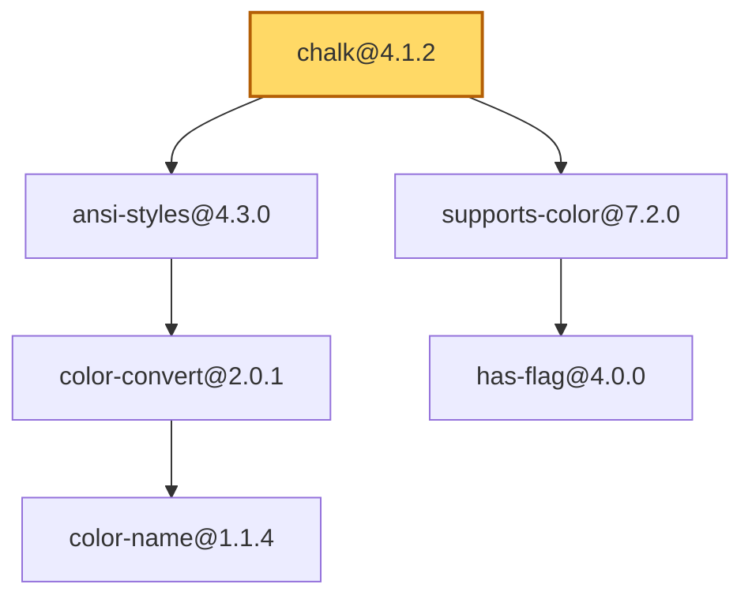
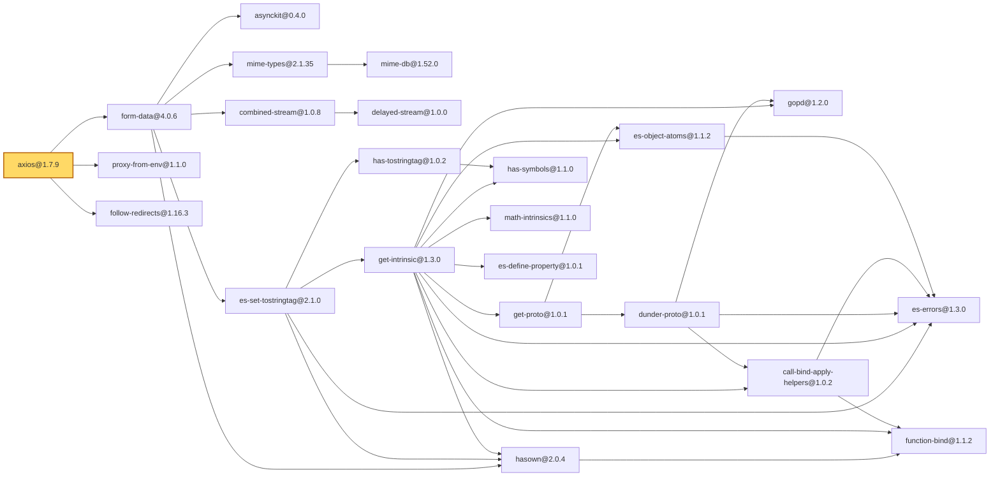
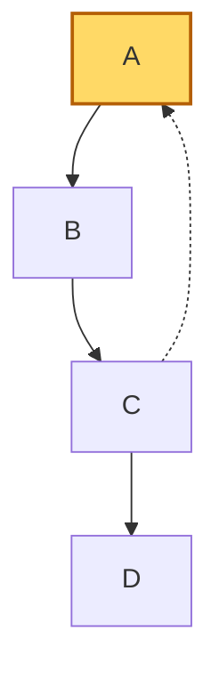

# Визуализатор графа зависимостей npm-пакетов (вариант 23)

CLI-инструмент для построения графа зависимостей пакетов JavaScript (npm).
Готовые менеджеры пакетов и библиотеки для получения зависимостей не используются.

Требования: Python 3.10+, PyYAML (`pip install -r requirements.txt`).

## Структура

```
src/            исходный код
  visualizer.py   точка входа (CLI)
  config.py       загрузка и проверка конфигурации
  npm_registry.py получение данных о пакетах из npm-репозитория
  semver.py       подбор версии зависимости по диапазону (^1.2.0, ~1.8.1, >=2 <3 ...)
  graph.py        построение графа зависимостей (DFS с рекурсией)
  test_repo.py    тестовый репозиторий из текстового файла
  mermaid.py      текст графа на языке Mermaid и HTML-страница с изображением
tests/          тестовые конфигурации, тестовые репозитории, модульные тесты и скрипт проверки
tools/          compare_with_npm.py — сравнение с выводом npm ls (этап 5)
output/         сгенерированные диаграммы .mmd и .html (не хранится в git)
config.yaml     конфигурация по умолчанию
run.bat, run.sh скрипты запуска (при первом запуске создают .venv и ставят зависимости)
```

## Этап 1. Минимальный прототип с конфигурацией

Запуск:

```
run.bat                      # Windows, используется config.yaml из текущего каталога
run.bat -c путь/к/файлу.yaml
./run.sh -c путь/к/файлу.yaml  # Linux/macOS
```

Параметры задаются в конфигурационном файле YAML:

| Ключ | Обязателен | Описание |
| --- | --- | --- |
| `package` | да | имя анализируемого пакета (npm-имя; в тестовом режиме — большие латинские буквы) |
| `repository` | да | URL репозитория (`http(s)://...`) или путь к файлу тестового репозитория |
| `test_repo_mode` | да | режим работы с тестовым репозиторием: `off` — реальный репозиторий по URL, `file` — файл описания графа |
| `version` | да | версия пакета в формате SemVer (`1.2.3`) или `latest`; записывайте в кавычках |
| `filter` | нет | подстрока для фильтрации пакетов (по умолчанию пустая) |
| `reverse_of` | нет | (этап 4) пакет, для которого выводятся обратные зависимости |

Относительный путь к файлу тестового репозитория отсчитывается от каталога конфигурационного файла.

На этапе 1 при запуске все параметры выводились в формате `ключ=значение`:

```
package=express
repository=https://registry.npmjs.org
test_repo_mode=off
version=4.21.2
filter=debug
```

### Обработка ошибок

Проверяются все параметры; все найденные ошибки выводятся сразу (в stderr), код возврата — 1.

- файл конфигурации не найден, пуст, не в UTF-8, содержит синтаксическую ошибку YAML;
- корень YAML не является словарём;
- отсутствуют обязательные параметры, есть неизвестные параметры;
- значение не строка (список, словарь, число — например, `version: 4.21`) или пустое;
- `package` — недопустимое имя npm-пакета / не большие латинские буквы в тестовом режиме;
- `repository` — не URL в режиме `off`, файл не найден в режиме `file`;
- `test_repo_mode` — значение не из списка `off`, `file`;
- `version` — не SemVer и не `latest`;
- `filter` — не строка.

Примеры корректных и ошибочных конфигураций — в `tests/configs/`,
демонстрация всех случаев — `tests/run_all.bat`.

## Этап 2. Сбор данных

Реализовано (модуль [src/npm_registry.py](src/npm_registry.py)):

- данные о пакете запрашиваются напрямую у npm-репозитория по HTTP
  (`<repository>/<пакет>/<версия>`) средствами стандартной библиотеки
  (`urllib`, `json`); менеджер пакетов npm и сторонние библиотеки не используются;
- поддерживаются пакеты с областью видимости (`@babel/core` → `@babel%2Fcore`)
  и версия `latest`;
- извлекаются прямые зависимости (поле `dependencies` манифеста) заданной версии пакета;
- на экран выводятся все прямые зависимости с диапазонами версий:

```
Прямые зависимости express@4.21.2:
  accepts ~1.3.8
  array-flatten 1.1.1
  body-parser 1.20.3
  ...
```

Обработка ошибок: пакет или версия не найдены (HTTP 404), другие ошибки HTTP,
нет соединения с репозиторием, превышено время ожидания, ответ не является JSON.

Примеры: `tests/configs/deps_*.yaml` (корректные) и `tests/configs/err_deps_*.yaml` (ошибки).

## Этап 3. Основные операции

Реализовано:

- граф зависимостей строится с учётом транзитивности алгоритмом **DFS с рекурсией**
  ([src/graph.py](src/graph.py)); каждый пакет раскрывается один раз;
- для реального репозитория версия каждой зависимости подбирается по её диапазону
  (наибольшая подходящая версия, как в npm) — собственная реализация SemVer
  в [src/semver.py](src/semver.py); узел графа — `имя@версия`;
- пакеты, имя которых содержит подстроку `filter`, не учитываются
  (вместе с зависимостями, достижимыми только через них);
- **циклические зависимости**: ребро в пакет, находящийся в текущем пути обхода,
  фиксируется как цикл, а обход по нему не продолжается — зацикливания нет;
- **режим тестирования** (`test_repo_mode: file`): вместо URL указывается путь к файлу
  описания графа, пакеты называются большими латинскими буквами:

```
# комментарий
A: B C      # A зависит от B и C
B: D
D:          # нет зависимостей
```

Пример вывода (`run.bat -c tests\configs\test_cycle.yaml`):

```
Граф зависимостей A (тестовый репозиторий: ../repos/cycle.txt)

  A -> B
  B -> C
  C -> A, D
  D -> (нет зависимостей)

Пакетов: 4, зависимостей (рёбер): 4
Циклические зависимости:
  A -> B -> C -> A
```

Случаи работы с тестовым репозиторием (`tests/repos/` и `tests/configs/test_*.yaml`):

| Конфигурация | Случай |
| --- | --- |
| `valid_test_mode.yaml` | общая зависимость (ромб A→B,C→D) |
| `test_chain.yaml` | длинная цепочка транзитивных зависимостей |
| `test_complex.yaml` | общие зависимости, неописанный пакет-лист, недостижимый пакет |
| `test_complex_from_q.yaml` | тот же репозиторий, анализ другого пакета |
| `test_cycle.yaml` | цикл A→B→C→A |
| `test_self_loop.yaml` | пакет зависит сам от себя |
| `test_multi_cycle.yaml` | несколько циклов |
| `test_filter.yaml` | фильтрация пакетов по подстроке |
| `test_filter_breaks_cycle.yaml` | фильтр исключает пакет из цикла |
| `err_test_repo_*.yaml`, `err_root_filtered.yaml` | ошибки: формат файла, пакета нет в репозитории, имя корня содержит подстроку фильтра |

Модульные тесты: `.venv\Scripts\python -m unittest discover -s tests`.

## Этап 4. Дополнительные операции

Режим вывода **обратных зависимостей**: пакеты, которые зависят от заданного пакета
(напрямую или транзитивно). Включается параметром `reverse_of` в конфигурации:

```yaml
package: A                 # граф зависимостей какого пакета анализируется
repository: ../repos/reverse.txt
test_repo_mode: file
version: "1.0.0"
reverse_of: G              # для какого пакета показать, кто от него зависит
```

Как работает ([src/graph.py](src/graph.py)):

1. строится граф зависимостей пакета `package` — как на этапе 3;
2. рёбра графа разворачиваются (`ReverseSource`): «зависимостями» пакета становятся
   пакеты, которые от него зависят;
3. по развёрнутому графу от пакета `reverse_of` выполняется **тот же обход
   в глубину** `build_graph` из этапа 3 — с той же обработкой циклов.

В реальном режиме `reverse_of` — имя npm-пакета (`safe-buffer`) или имя с версией
(`safe-buffer@5.2.1`); если в графе есть несколько версий пакета, выводятся
обратные зависимости каждой.

Пример вывода (`run.bat -c tests\configs\rev_basic.yaml`):

```
Обратные зависимости G в графе зависимостей A (тестовый репозиторий: ../repos/reverse.txt)

  G <- D, E
  D <- B
  B <- A
  A <- (от него никто не зависит)
  E <- B, C
  C <- A

Пакетов, зависящих от G: 5 (напрямую: 2)
  напрямую: D, E
  транзитивно: B, A, C
```

Случаи работы с тестовым репозиторием (`tests/configs/rev_*.yaml`, `err_rev_*.yaml`):

| Конфигурация | Случай |
| --- | --- |
| `rev_basic.yaml` | прямые и транзитивные обратные зависимости, несколько путей |
| `rev_single_path.yaml` | единственная цепочка зависимых пакетов |
| `rev_root.yaml` | от корневого пакета никто не зависит |
| `rev_cycle.yaml` | обратные зависимости в графе с циклом |
| `rev_filter.yaml` | фильтр исключает часть зависимых пакетов |
| `rev_complex_from_q.yaml` | сложный граф с общими зависимостями |
| `rev_npm_express.yaml` | реальный npm: кто в графе express зависит от safe-buffer |
| `err_rev_*.yaml` | ошибки: пакет не входит в граф, неверное имя, имя содержит подстроку фильтра |

## Этап 5. Визуализация

Реализовано ([src/mermaid.py](src/mermaid.py)):

- **текстовое представление графа на языке диаграмм Mermaid** (`flowchart`),
  формируется без сторонних библиотек: стрелка `A --> B` означает «A зависит от B»,
  ребро, замыкающее цикл, рисуется пунктиром `-.->`, корневой пакет выделен цветом;
- **изображение графа**: создаётся HTML-страница, на которой библиотека mermaid.js
  рисует диаграмму, и страница открывается в браузере (нужен интернет для загрузки
  mermaid.js). По умолчанию граф вписан в окно, флажок «реальный размер» показывает детали;
- визуализируется и граф обратных зависимостей (этап 4), стрелки в нём тоже
  указывают направление зависимости.

При каждом запуске программа выводит текст Mermaid на экран, сохраняет его в
`output/<пакет>.mmd`, сохраняет `output/<пакет>.html` и открывает изображение.

Параметры командной строки:

```
run.bat -c файл.yaml              # построить граф и открыть изображение
run.bat -c файл.yaml --no-show    # только сохранить .mmd и .html, браузер не открывать
run.bat -c файл.yaml -o папка     # каталог для диаграмм (по умолчанию output)
```

### Примеры визуализации для трёх пакетов

Конфигурации `tests/configs/viz_chalk.yaml`, `viz_axios.yaml`, `viz_express.yaml`.
GitHub показывает блоки `mermaid` ниже как картинки.

**chalk@4.1.2** — 6 пакетов, 5 зависимостей (`run.bat -c tests\configs\viz_chalk.yaml`):



**axios@1.7.9** — 23 пакета, 34 зависимости (`run.bat -c tests\configs\viz_axios.yaml`):



**express@4.21.2** — 69 пакетов, 125 зависимостей (`run.bat -c tests\configs\viz_express.yaml`).
Диаграмма слишком велика для README; текст — в `output/express_4.21.2.mmd` после запуска.

Тестовый репозиторий с циклом (`run.bat -c tests\configs\test_cycle.yaml`):



### Сравнение со штатными инструментами npm

Штатный инструмент npm для просмотра дерева зависимостей — `npm ls --all`.
Для сравнения каждый пакет был установлен в пустой проект
(`npm install <пакет>@<версия> --omit=dev --ignore-scripts`, npm 10.9.9, Node.js 22),
после чего дерево `npm ls --all --json` сравнивалось с графом программы
скриптом [tools/compare_with_npm.py](tools/compare_with_npm.py)
(сравниваются множества пакетов `имя@версия` и рёбер «пакет → зависимость»).

| Пакет | npm ls | Программа | Результат |
| --- | --- | --- | --- |
| chalk@4.1.2 | 6 пакетов, 5 рёбер | 6 пакетов, 5 рёбер | совпадает |
| axios@1.7.9 | 23 пакета, 34 ребра | 23 пакета, 34 ребра | совпадает |
| express@4.21.2 | 69 пакетов, 125 рёбер | 69 пакетов, 125 рёбер | совпадает |

**Найденное и устранённое расхождение.** В первой версии программа давала для axios
и express на 3 пакета больше: вместо `get-intrinsic@1.3.0` выбиралась `get-intrinsic@1.3.1`
(у неё есть дополнительные зависимости `async-function`, `async-generator-function`,
`generator-function`). Причина: программа брала наибольшую версию, подходящую под
диапазон `^1.2.6`, а npm сначала проверяет версию с тегом `latest` — у `get-intrinsic`
это 1.3.0 — и, если она подходит под диапазон, выбирает её, даже если опубликована
более новая. Кроме того, npm избегает устаревших (deprecated) версий. Оба правила
добавлены в программу (`pick_version` в [src/npm_registry.py](src/npm_registry.py)),
после чего графы совпали.

**Остающиеся отличия в представлении** (не в данных):

- `npm ls` выводит **дерево**: пакет, нужный нескольким другим, показывается в каждом
  месте, повторы помечаются `deduped`. Программа строит **граф**: каждый пакет — один
  узел, к которому ведут несколько стрелок;
- `npm ls` показывает **фактически установленные** версии (зафиксированные в
  `package-lock.json` на момент установки), а программа выбирает версии по состоянию
  реестра на момент запуска. Если позже будут опубликованы новые версии зависимостей,
  результаты могут разойтись, пока проект не будет переустановлен;
- программа учитывает только поле `dependencies`. npm при установке ставит также
  `optionalDependencies` и `peerDependencies` (npm 7+); у трёх рассмотренных пакетов
  их нет, поэтому на результат это не повлияло;
- если в npm несколько версий одного пакета, они лежат во вложенных `node_modules`;
  в программе это просто разные узлы `имя@версия1` и `имя@версия2`;
- фильтр по подстроке (`filter`) есть только в программе.
